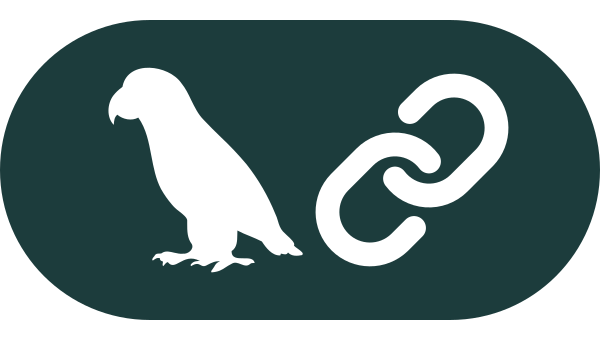
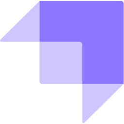

Hi, I'm **Kayke Queiroz dos Santos** 👨‍💻
 

**Software Engineering student** at **IDP** (6th semester) • **Google Student Ambassador** • **IEEE Member**

Focused on **AI Engineering** and **Full-Stack Development**. I develop AI-powered applications, LLM agents, and robust backend services using Python, TypeScript, and modern orchestration frameworks. 

Passionate about automating workflows, optimizing model inference costs, and building scalable software that solves practical challenges.

---

## 🚀 Projects

  &nbsp;
  &nbsp;
  
  
  

---

## 🤖 AI Engineering & Agents

  &nbsp;&nbsp;
  &nbsp;&nbsp;
  &nbsp;&nbsp;
  &nbsp;&nbsp;
  

---

## 🧠 Languages & Core

  &nbsp;&nbsp;
  &nbsp;&nbsp;
  &nbsp;&nbsp;
  

---

## ⚛️ Frameworks & Backend

  &nbsp;&nbsp;
  &nbsp;&nbsp;
  &nbsp;&nbsp;
  &nbsp;&nbsp;
  &nbsp;&nbsp;
  

---

## 🛠️ Tools, Cloud & Databases

  &nbsp;&nbsp;
  &nbsp;&nbsp;
  &nbsp;&nbsp;
  &nbsp;&nbsp;
  &nbsp;&nbsp;
  &nbsp;&nbsp;
  

---

## 👾 My Contribution Graph 👾

<picture>
  <source media="(prefers-color-scheme: dark)" 
    srcset="https://raw.githubusercontent.com/Kayke-Queiroz/Kayke-Queiroz/output/pacman-contribution-graph-dark.svg">
  
</picture>

